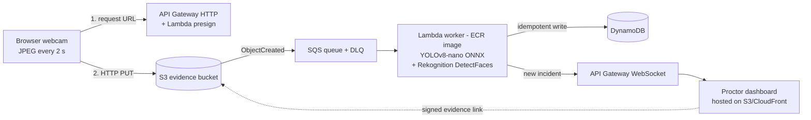

# CAD Project

**Serverless, event-driven remote exam proctoring on AWS: 2 s webcam frame sampling, YOLOv8-nano + Amazon Rekognition inference, and live proctor alerts with evidence.**

> *Placeholder name. Course project for BCSE355L.*

The system assists human proctors by flagging potentially suspicious visual events (phone in view, multiple people, prolonged head turn, face obstructed) from periodic webcam frames. It does **not** decide whether misconduct occurred; every alert is evidence for a proctor to review.

---

## Problem

A proctor cannot watch hundreds of webcams at once. Continuous video streaming (~2.5 Mbps per candidate) needs heavy bandwidth and always-on media servers. This project replaces streaming with **one compressed JPEG every 2 s** (~80-120 KB, roughly 0.3-0.5 Mbps) processed as independent, stateless events. Compute scales with active sessions and drops to zero when idle.

## Architecture



## AWS services

| Service | Role |
|---|---|
| **S3** | Frame uploads (pre-signed PUT) and evidence storage |
| **API Gateway (HTTP)** | Endpoint to request pre-signed upload URLs |
| **API Gateway (WebSocket)** | Pushes live alerts to the proctor dashboard |
| **Lambda** | Presign function, inference workers, WebSocket handlers |
| **SQS (+ DLQ)** | Buffers S3 events; retries; dead-letters failures |
| **DynamoDB** | Incident records and WebSocket connection IDs |
| **Rekognition** | `DetectFaces` for head pose and face obstruction |
| **ECR** | Hosts the Lambda container image (YOLOv8-nano + ONNX Runtime) |
| **IAM** | Least-privilege role per function |
| **CloudWatch** | Logs, metrics, alarms, latency measurement |
| **CloudFront** *(optional)* | Hosts the frontend with S3 |

## Detection

| Event | Method |
|---|---|
| Mobile phone | YOLOv8-nano (`cell phone` class) |
| Multiple people | YOLOv8-nano (`person` count > 1) |
| Head turned away | Rekognition pose (yaw/pitch beyond threshold, sustained across N frames) |
| Face obstructed / absent | Rekognition occlusion/confidence; no face found |

Thresholds and the consecutive-frame count are configurable. Rekognition is called only when YOLO finds a person, to control cost.

## Incident record

```json
{
  "sessionId": "exam-101#cand-042",
  "eventTime": "2026-10-12T09:14:22.318Z",
  "eventType": "PHONE_DETECTED",
  "confidence": 0.91,
  "severity": "HIGH",
  "evidenceKey": "exam-101/cand-042/1760260462318.jpg"
}
```

## Reliability and security

- **Idempotency:** deterministic incident key (session + object key + event type) with conditional writes, so duplicate S3 notifications never create duplicate incidents.
- **Fault isolation:** each frame is an independent invocation; failures retry via SQS and move to a DLQ after max receives.
- **Access control:** least-privilege IAM per function; short-lived pre-signed URLs scoped to one session prefix; per-session token checked by the presign function; proctor dashboard protected by a simple token login.
- **Data protection:** S3 and DynamoDB encryption at rest (AWS defaults), HTTPS in transit, S3 lifecycle rule for evidence retention.
- **Privacy:** consent screen before camera access.

## Evaluation

Results are recorded in [`docs/benchmarks.md`](docs/benchmarks.md).

| Metric | Measured |
|---|---|
| Capture-to-alert latency (p50 / p95, warm) | TBD |
| Cold-start latency | TBD |
| Detection precision / recall per event type | TBD |
| Duplicate-incident rate | TBD |
| Cost per monitored candidate-hour | TBD |

## Repository structure

```
cad-project/
├── frontend/        # Candidate capture page + proctor dashboard
├── backend/
│   ├── presign/     # Pre-signed URL Lambda
│   ├── inference/   # Container Lambda (ONNX + Rekognition) + Dockerfile
│   └── notify/      # WebSocket connect/disconnect/push handlers
├── models/          # YOLOv8-nano ONNX export script
├── eval/            # Test images and measurement scripts
└── docs/            # Architecture, setup, benchmarks
```

## Getting started

See [`docs/setup.md`](docs/setup.md) for step-by-step AWS setup (console or CloudFormation/SAM).

## Known limitations

- 2 s sampling can miss events shorter than the interval.
- Detections are probabilistic; false positives are expected, so a human reviews every alert.
- Lambda container cold starts add latency to the first frames after idle.
- Auth is simplified (session/proctor tokens); production would use Amazon Cognito.
- Lighting, camera angle and webcam quality affect accuracy.
- Rekognition cost scales per image.

## License

MIT
